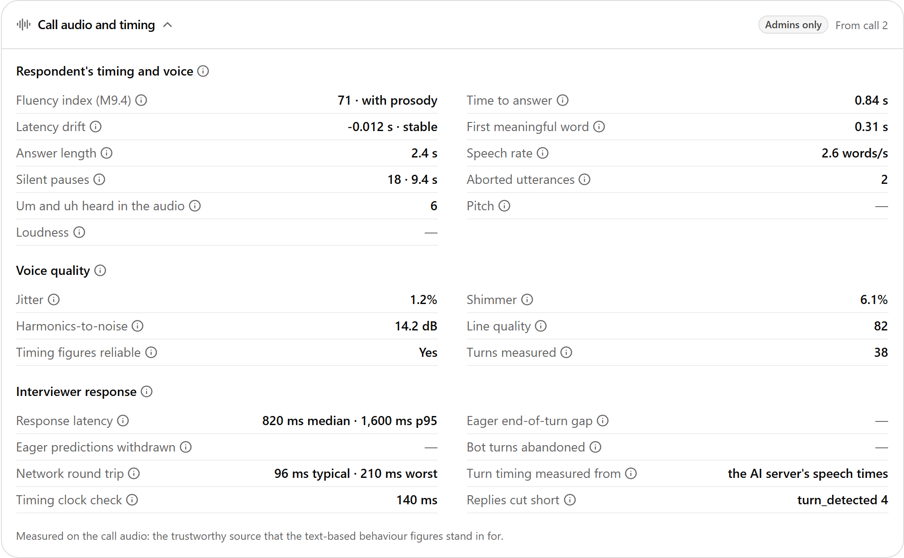
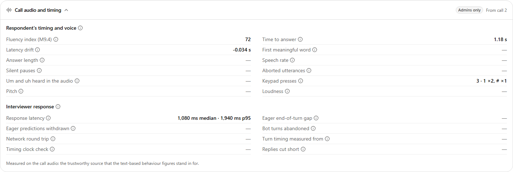

The **Call audio and timing** panel on a sample record is shown to **platform admins only**, folded until opened. It holds the measurements taken from the call audio: the trustworthy source that the text-based behaviour figures stand in for.

<Frame>
  
</Frame>

## How a turn is timed

Every timing metric is built from the respondent's **turns**: one turn runs from the moment the respondent starts speaking to the moment they stop. Words are counted from the turn's transcript.

* **Standard pipeline:** the start and stop come from the speech-recognition turn signals, as they arrive.
* **Live pipeline** (calls from 23 November 2026): the start and stop come from the AI server's own record of when the speech started and stopped, with the server's 300 ms lead-in added to the start and its 500 ms end-of-turn wait taken off the stop. Earlier Live calls were timed from when the signals arrived, which ran late. The panel says which basis the call used (**Turn timing measured from**); compare timings only between calls on the same basis.
* On a text test (dual chatbot) there is no audio, so none of these metrics exist.

---

## Respondent's timing

### Time to answer (M1.1)

**What it measures:** the silence between the interviewer finishing and the respondent starting to speak.

**How it is worked out:** for each turn, the moment the respondent started speaking minus the moment the interviewer stopped. A turn where the respondent started while the interviewer was still speaking (a barge-in) has no time to answer and is left out. The call figure is the mean over the turns that have one.

**Unit:** seconds, 0 or more.

**How to read it:** a behaviour signal, not good or bad by itself. A respondent who needs longer on some questions than on others is the interesting pattern; see the sensitive-question contrasts in [Respondent Behaviour](/AI-CATI/Metrics-Respondent-Behaviour#sensitive-question-contrasts). Typical conversational answers start within one second.

**Watch out:** a respondent who often talks over the interviewer has fewer timed turns. Mobile and internet lines add delay (see [Line type](/AI-CATI/Metrics-Call-Quality#line-type-m83)).

**Where:** the admin panel; per question on the Result tab.

### Answer length (M1.2)

**What it measures:** how long the respondent spoke in each answer.

**How it is worked out:** each turn's stop minus its start; the call figure is the mean. On Live calls the server's end-of-turn wait is taken off, so the length is the speech itself.

**Unit:** seconds.

**How to read it:** very short answers throughout are the *Answering too fast* check (under 1.2 seconds on average); long answers usually mean explanations or hedging.

**Where:** the admin panel; per question on the Result tab.

### Speech rate (M1.3)

**What it measures:** how fast the respondent spoke.

**How it is worked out:** for each turn with words and a length, words divided by seconds; the call figure is the mean of the turns.

**Unit:** words per second (conversational speech is typically 2 to 3).

**How to read it:** a drop on sensitive questions can mean the respondent was choosing words carefully. It also feeds the fluency index.

**Where:** the admin panel; per question on the Result tab.

### First meaningful word (M1.4)

**What it measures:** how long it took to reach a word that carries meaning, after fillers and false starts ("um, well, so... yes").

**How it is worked out:** the start of the first word that is not a filler (um, uh, er, hmm, well, so, like, okay and their equivalents), measured from the start of the turn's *first recognised word*. A turn that begins with a real word reads 0.

* **Standard:** from the speech recognizer's word timings during the call.
* **Live:** from a second transcription of the recording made after the call. Only when the recording may be kept.

Both pipelines measure from the same point, so the figures can be compared. The call figure is the mean over turns.

**Unit:** seconds.

**How to read it:** the time spent on fillers and false starts before the answer itself. The silence before the respondent made any sound is the time to answer (M1.1), not this.

**Where:** the admin panel.

### Latency drift and trust trend (M1.5, M7.1)

**What it measures:** whether the respondent answered faster or slower as the call went on.

**How it is worked out:** the slope of the time to answer across the call's turns (a straight line fitted through them). Needs at least two turns. The **trust trend** reads that slope: faster than 0.02 seconds per turn is **trust building**, slower than 0.02 is **trust declining**, anything in between is **stable**.

**Unit:** seconds per turn; negative means answering faster.

**How to read it:** a respondent who relaxes into the interview answers faster; one who becomes guarded or tired answers slower. It is a single-call reading, not a comparison with earlier interviews.

**Where:** the admin panel (**Latency drift**, with the trust trend after it).

---

## Pauses

### Silent pauses and pause time (M2.1, M2.2)

**What it measures:** silences *inside* the respondent's answers.

**How it is worked out:** each answer's audio (up to 15 seconds) is cut into 25 ms slices. A slice is silent when it is much quieter than the answer's own average (under 15 in 100 of its loudness), so the rule adapts to a quiet or loud line. A pause is a run of silent slices lasting a quarter of a second (250 ms) or more. The call figures are the number of pauses and their total length over all answers.

**Unit:** a count, and seconds.

**How to read it:** more pauses on sensitive questions than on neutral ones is the useful signal (see [sensitive-question contrasts](/AI-CATI/Metrics-Respondent-Behaviour#sensitive-question-contrasts)). A noisy line can hide pauses; a breaking-up line can add them.

**Standard / Live:** the same method. On Live calls, the server's end-of-turn wait is cut off and the start of the answer is recovered, so the figures cover the speech itself.

**Where:** the admin panel; per question on the Result tab.

### Aborted utterances (M2.6)

**What it measures:** speech that started and was abandoned before it became words: a cough, a "hello?" over the interviewer, an answer begun and dropped.

**How it is worked out:**

* **Standard:** a turn where the speech recognizer produced a partial result that never became a final one.
* **Live:** a turn the AI server opened and closed whose transcript came back blank, or never came.

**Unit:** count.

**Where:** the admin panel.

### Um and uh heard in the audio (M2.3, audio)

**What it measures:** hesitation sounds in the recording itself.

**How it is worked out:** after the call, the recording is transcribed a second time with hesitation words kept, and the words "uh", "um", "er", "erm", "hmm" and "uhm" are counted. "Mhmm" and "uh-huh" are not counted: they mean yes.

**Unit:** count.

**Standard / Live:** **Live only, English calls only**, and only when the recording may be kept. On other calls, filled pauses are counted from the transcript instead (see [Respondent Behaviour](/AI-CATI/Metrics-Respondent-Behaviour#filled-pauses-m23)).

**Where:** the admin panel.

### Keypad presses

<Frame>
  
</Frame>

**What it measures:** how many times the respondent pressed a key on their phone during the call, and which keys.

**How it is worked out:** the phone line sends a signal for every key pressed; each one is counted once. The interview does not react to the keys: they are only counted.

**Unit:** count, then each key with its count (for example `3 · 1 ×2, # ×1`).

**Standard / Live:** the same on both.

**How to read it:** most calls have none. Presses can show a respondent who expected a keypad menu, who tried to skip or end the call, or who struggled to hear. A dash means the provider metric **Keypad presses** was off for the study; **0** means it was on and nobody pressed a key.

**Where:** the admin panel, **Respondent's timing and voice** group. Needs the provider metric **Keypad presses** (on by default).

---

## Respondent's voice

### Pitch and pitch range (M3.1, M3.2)

**What it measures:** how high the respondent's voice was, and how much that changed between answers.

**How it is worked out:** one pitch estimate per answer, from a quarter-second slice in the middle of the answer, between 70 and 400 Hz. An answer with no clear pitch (whispered, noisy) is left out. **Pitch** is the mean of the answers; **range** is the highest minus the lowest, and needs at least two answers.

**Unit:** Hz.

**How to read it:** only meaningful **within one call**: a voice rising on sensitive questions compared with the same person's neutral answers (see [prosodic shift](/AI-CATI/Metrics-Respondent-Behaviour#prosodic-shift-m44)). Pitch differs naturally between people.

**Where:** the admin panel.

### Loudness and loudness variation (M3.3, M3.4)

**What it measures:** how loud the respondent spoke, and how much that changed between answers.

**How it is worked out:** the average signal level of each answer, in decibels below full scale; **loudness** is the mean over answers, **variation** is their spread and needs at least two answers.

**Unit:** dB below full scale (a negative number; closer to 0 is louder).

**How to read it:** within one call only: the phone, the line and the distance from the phone change loudness more than the person does. A fall in loudness over the call is one of the fatigue signs.

**Where:** the admin panel.

### Rhythm smoothness (M3.5)

**What it measures:** how even the rhythm of the respondent's speech was.

**How it is worked out:** from the call recording, after the call: the loudness peaks of each answer (roughly its syllables) are found, and the gaps between them compared. Even gaps give a score near 1, irregular ones a lower score. Answers shorter than 0.3 seconds or with fewer than four peaks are skipped; the call figure is the mean.

**Unit:** 0 to 1; higher is smoother.

**How to read it:** feeds the fluency index. Needs a recording.

**Where:** stored with the call; part of the fluency index.

### Voice quality: jitter, shimmer, harmonics-to-noise (M3.6)

**What it measures:** small irregularities in the voice that rise with strain, tension or hoarseness.

**How it is worked out:** from the call recording, after the call, on the respondent's side only. In each answer longer than 0.2 seconds, the voiced parts are found and the voice's individual cycles tracked:

* **Jitter:** how much the length of one cycle differs from the next, as a share of the average cycle.
* **Shimmer:** how much the loudness of one cycle differs from the next, as a share of the average.
* **Harmonics-to-noise:** how much of the voice is tone rather than breath or noise.

An answer needs at least 12 cycles to be measured. The call figures are the means over the measured answers.

**Unit:** jitter and shimmer in percent; harmonics-to-noise in dB (between −20 and 40).

**How to read it:** higher jitter or shimmer and lower harmonics-to-noise mean a less steady voice, from strain or from a poor line. Phone audio is band-limited, so read these **within one call** (sensitive against neutral answers), never against studio norms. A voice is treated as strained on sensitive questions when jitter is more than 1.2 times the neutral level or harmonics-to-noise falls by more than 2 dB.

**Where:** the admin panel (**Voice quality**), with **Turns measured** showing how many answers were measurable.

---

## Fluency index (M9.4)

**What it measures:** how fluently the respondent spoke over the whole call.

**How it is worked out:** three parts, each from 0 to 1:

* **Rate stability:** how steady the speech rate was between answers (1 minus its relative spread).
* **Low silence:** 1 minus the share of answer time spent in silent pauses.
* **Rhythm:** the rhythm smoothness (M3.5).

With a recording: 50 × rate stability + 30 × rhythm + 20 × low silence (**with prosody**). Without one: 60 × rate stability + 40 × low silence (**without prosody**).

**Unit:** 0 to 100; higher is more fluent.

**How to read it:** below 40 takes 15 points off the [usability score](/AI-CATI/Metrics-Call-Quality#usability-score-m95). Compare only figures with the same basis.

**Where:** the admin panel.

---

## Interviewer response

### First words after pickup

**What it measures:** how long the line was silent between the person picking up and the interviewer's first sound.

**How it is worked out:** once per call, from the moment the call connected to the first audio the interviewer sent.

**Unit:** seconds. **How to read it:** lower is better. The line is silent until the interviewer speaks, and people hang up on a silent line; a long wait here is a likely reason for a hang-up in the first seconds.

**Where:** the admin panel. Both pipelines.

### Response latency

**What it measures:** how long the respondent waited for the interviewer after they stopped speaking.

**How it is worked out:** for each turn, from the moment the respondent stopped speaking to the moment the interviewer's voice started. The panel shows the median and the slowest 5 percent (p95) over the call.

**Unit:** milliseconds.

**How to read it:** lower is better; long waits make respondents repeat themselves or hang up. Dashboard colours: median green up to 1,500 ms, amber up to 3,000 ms; p95 green up to 3,000 ms, amber up to 5,000 ms.

**Where:** the admin panel, the quality panel and the dashboard (**Latency p50**).

### Bot turns abandoned

**What it measures:** interviewer replies that were started and interrupted before a word was spoken.

**Unit:** count. **Where:** the admin panel.

### Eager end-of-turn gap and predictions withdrawn

**What it measures:** Standard pipeline tuning only: how much earlier an early guess that the respondent had finished came than the confirmed end, and how often the respondent then kept talking.

**Where:** the admin panel, when that tuning is switched on.

### Network round trip (M8.1)

**What it measures:** the time for a message to travel from VoxDash to the realtime AI server and back.

**How it is worked out:** the connection measures its own round trip about every 20 seconds; the value is sampled at each respondent turn. The panel shows the typical (median) and worst values.

**Unit:** milliseconds.

**How to read it:** **Live only**. It is **not** the phone line's delay. Dashboard colours: green up to 200 ms, amber up to 400 ms.

**Where:** the admin panel and the dashboard.

### Speech synthesis time (Azure)

**What it measures:** how long Azure's speech service took to turn the interviewer's text into audio: until the first piece of audio was ready, and until the whole sentence was ready.

**How it is worked out:** Azure reports both times for every sentence it speaks. The panel shows the typical value (median) of each over the call.

**Unit:** milliseconds.

**How to read it:** the time to the first sound is the part of the interviewer's response time that the voice adds; compare it with **Response latency**. When it is a large share of the response latency, the voice, not the AI model, is what the respondent waits for. **Standard pipeline with an Azure voice only**; other voices and Live calls show a dash.

**Where:** the admin panel.

### Where the synthesis time went

**What it measures:** the time to the first sound, split by Azure into the speech service working on the sentence, the network between VoxDash and Azure, and opening the connection.

**How it is worked out:** Azure reports the three parts for every sentence; the panel shows the median of each over the call.

**Unit:** milliseconds.

**How to read it:** a large network or connection part points to the link to Azure (region, connection reuse); a large service part points to Azure being slow for that voice or region. **Standard pipeline with an Azure voice only.**

**Where:** the admin panel.

### Lowest usage-limit headroom (OpenAI)

**What it measures:** how close the OpenAI account came to its request and token limits during the call.

**How it is worked out:** during a Live call OpenAI keeps reporting how many requests and tokens are left before it starts refusing work. The panel shows the lowest point of the call: the share of the allowance left, and the requests and tokens left at that moment.

**Unit:** percent of the allowance; requests; tokens.

**How to read it:** a low share means the account was near its limit, and other calls running at the same time could have been slowed or refused. A study that sees it often needs a higher account limit or fewer calls at once. **Live (OpenAI) only.**

**Where:** the admin panel.

### Turn timing measured from

**What it shows:** where the respondent's start and stop times came from: **the AI server's speech times** (Live calls since 23 November 2026), **when the turn signals arrived** (Standard calls and earlier Live calls), or **both** (some turns of each). Compare timing figures only between calls with the same value.

### Timing clock check

**What it shows:** Live only. For each turn the AI server ended, how far the audio already sent was ahead of the server's stop time; the smallest value is shown. A **negative** value means the server named audio that was never sent, so that turn could not be placed on the server's clock and kept the older timing. The panel says how many turns did.

### Replies cut short

**What it shows:** Live only: replies the AI did not finish, by the server's reason. **turn_detected** means the respondent spoke over the interviewer; **content_filter** or **max_output_tokens** mean the server stopped the reply.

### Turns closed by the wait timer

**What it measures:** Standard pipeline only. Respondent turns that ended because a wait timer ran out, not because turn detection decided the person had finished speaking.

**How it is worked out:** a turn whose end came at 90 in 100 or more of the configured wait is counted as closed by the timer. The panel shows the count out of the turns measured, and the share.

**Unit:** count and percent. **How to read it:** each of these turns added the timer's full wait before the interviewer replied. A high share means the turn detection settings need fixing, not the AI model or the network. Not shown on Live, which has no such timer.

### Second transcription

**What it measures:** Live only. How often the live transcript and a second transcription of the recording disagreed about what the respondent said.

**How it is worked out:** after the call, the respondent's side of the recording is transcribed a second time by Deepgram, and each of its lines is matched to a line of the live transcript. The panel shows the lines that differ out of the lines matched, and the share. When the second transcription did not run, the panel says why: **Switched off**, **No recording**, **Not done: the recording may not be kept**, **Failed**, **Timed out** or **Not set up on the server**.

**Unit:** count and percent. **How to read it:** a high share means the live transcript often misheard the respondent: check the answers flagged for review against the recording. The answer checks after the call already read both transcriptions and flag only what neither supports.

### Option lists read again

**What it measures:** times the interviewer read a question's full option list again after it had already read it once.

**How it is worked out:** counted from the interviewer's own lines, so it is known on every call, including calls with no audio measurements.

**Unit:** count. **How to read it:** several on one call point to an option list that is long or hard to follow on the phone. Compare with **Asked to clarify** on the [Respondent behaviour](/AI-CATI/Metrics-Respondent-Behaviour#asked-to-clarify-m52) page.
