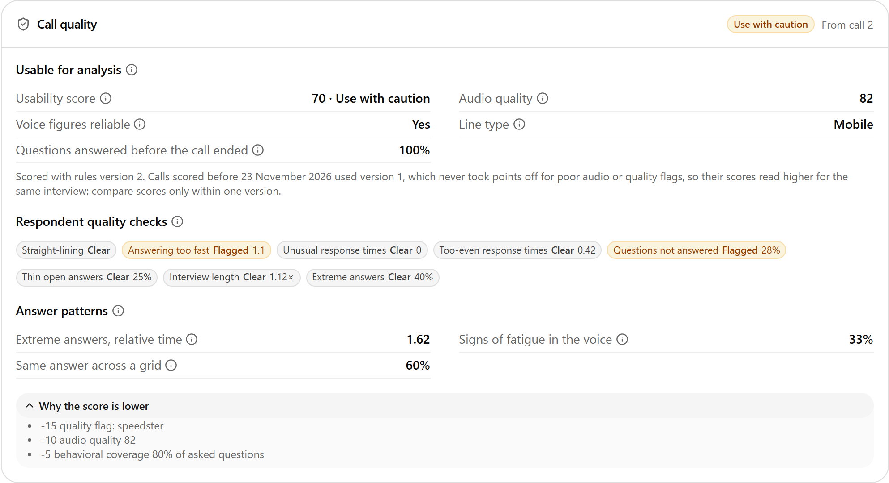
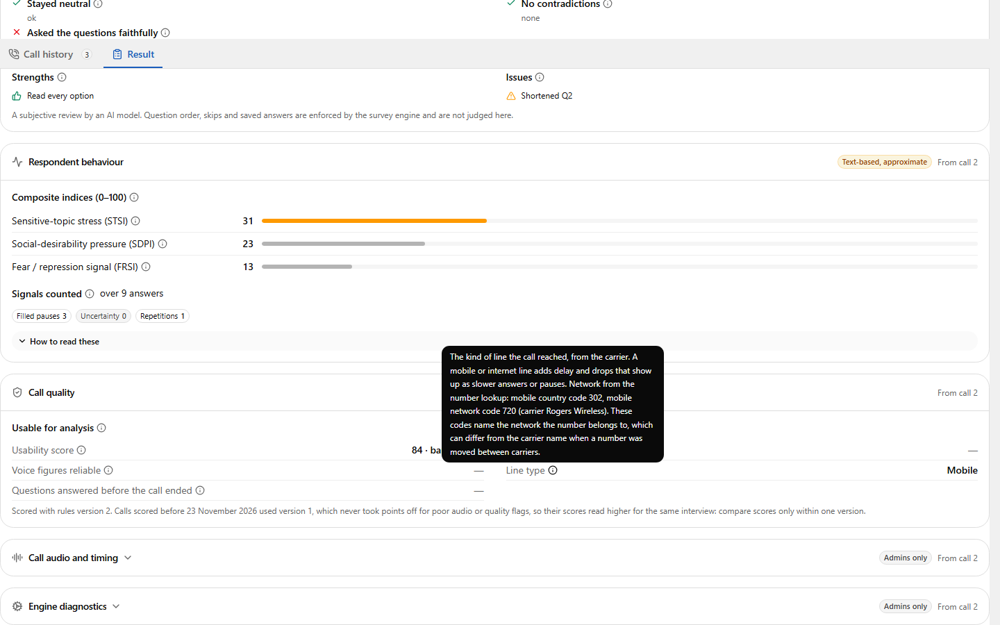

The **Call quality** card on a sample record (and on each self-test call) answers one question: can this interview be used for analysis? Every viewer of the record sees it. The same measures, over every call of the study, are on the [Live Monitoring](/AI-CATI/Live-Monitoring#interview-quality) dashboard.

<Frame>
  
</Frame>

<Note>
  The screenshots on this page show example figures.
</Note>

---

## Usable for analysis

### Usability score (M9.5)

**What it measures:** whether this interview is safe to use in the analysis, as one score with a band.

**How it is worked out:** first the audio gate: if the call's [audio quality](#audio-quality-m82) is below 70, the call is **excluded** and the score is the audio quality itself. Otherwise the score starts at 100 and loses points for each problem found:

| Problem | Points off |
| --- | --- |
| Fewer than half of the asked questions could be matched to a measured answer | 30 |
| Fewer than 80 in 100 of them could be | 15 |
| No question could be measured at all | 30 |
| Fewer than 5 respondent answers on the call | 20 |
| [Fluency index](/AI-CATI/Metrics-Audio-and-Timing#fluency-index-m94) below 40 | 15 |
| Speech-recognition confidence below the study's confidence floor, 0.60 by default (below 0.75: 10) | 25 |
| Each of these checks raised: straight-lining, answering too fast, unusual response times | 15 each |
| Audio quality from 70 to 84 | 10 |

**Unit and bands:** 0 to 100. **75 and above: High quality. 45 to 74: Use with caution. Below 45: Exclude.**

**How to read it:** **Why the score is lower** under the card lists every deduction for that call, so the score can be checked rather than trusted. On the Live pipeline there is no speech-recognition confidence, so that deduction never applies there. When no audio quality could be measured, the gate does not run and the card says so.

**Versions:** the card shows the rules version. Version 2 (calls from 23 November 2026) applies the audio gate and the quality-check deductions; version 1 never did, so its scores read higher for the same interview. Compare scores only within one version; the dashboard averages version 2 only.

**Where:** the Call quality card, the record's quality panel, the dashboard.

### Audio quality (M8.2)

**What it measures:** the signal quality of the respondent's side of the recording.

**How it is worked out:** after the call, from the recording. For each answer, the loud parts (speech) are compared with the quiet parts (the noise floor) to give a signal-to-noise ratio, and the share of samples that hit the maximum level (clipping) is measured. Each answer scores 100 × (signal-to-noise ÷ 30 dB, at most 1), minus up to 40 points for clipping. The call figure is the mean over answers.

**Unit:** 0 to 100; higher is better. 30 dB signal-to-noise or more with no clipping scores 100.

**How to read it:** below 70 the line was too poor for the timing and voice figures to describe the respondent: the call is excluded from usability and the figures are marked unreliable. 70 to 84 costs 10 usability points. It is a signal measure, not a call-quality (MOS) score: it does not include network packet loss.

**Where:** the Call quality card, the admin panel (**Line quality**), the dashboard. Needs a recording.

### Voice figures reliable (M10.1)

**What it measures:** whether the timing and voice figures of this call can be trusted.

**How it is worked out:** **Yes** when the audio quality is 70 or more, **No** below.

**How to read it:** **No** means a noisy line: the pauses, pitch, loudness and voice quality describe the line more than the respondent. Read them with caution.

**Where:** the Call quality card; the admin panel (**Timing figures reliable**).

### Line type (M8.3)

**What it measures:** the kind of line the call reached.

**How it is worked out:** looked up from the phone carrier when the call is dialled: **Landline**, **Mobile**, **Internet phone (VoIP)** or **Browser call**. Other types the carrier reports are shown as sent.

**How to read it:** mobile and internet lines add delay (about 0.08 and 0.15 seconds) and drop-outs that look like slower answers or extra pauses. Compare timing between calls on the same kind of line.

**Network:** with the provider metric **Line details from the number lookup** on (the default), the row's hint also gives the mobile country code and mobile network code of the number and the carrier's name. These codes name the network the number belongs to, which can differ from the carrier name when a number was moved between carriers. When the lookup returned an error, the hint gives its code, and the line type may be missing or less certain. The codes are kept exactly as the carrier sent them.

<Frame>
  
</Frame>

**Where:** the Call quality card.

### Questions answered before the call ended (M5.5)

**What it measures:** how far the respondent got before hanging up.

**How it is worked out:** if the call did not end in a hang-up, the full share. Otherwise, the questions asked that have an answer, divided by the questions asked.

**Unit:** 0 to 100 percent.

**How to read it:** a low share with a hang-up on a sensitive question is the pattern the fear / repression index (FRSI) looks for.

**Where:** the Call quality card.

---

## Respondent quality checks

Checks on the answers and their timing, run after the call. They are **information for review**: they never change the call's outcome. Each badge says **Flagged** or **Clear**, with the figure it was judged on. A check that could not run on the call is not shown, rather than shown as clear. The limits are starting points, not yet calibrated on real fieldwork.

### Straight-lining

**What it measures:** giving the same answer mechanically.

**How it is worked out:** flagged when either:

* in a grid question, the most chosen column covers 3 rows or more **and** 75 in 100 of the grid's rows, or
* 4 or more standalone scale questions in a row got the identical answer.

**Shown with:** the worst grid's run. **Where:** the card, the quality panel, the dashboard (**Straight-liners**). Costs 15 usability points.

### Answering too fast

**What it measures:** answers too short for a considered reply.

**How it is worked out:** the mean answer length below 1.2 seconds. Without audio, the mean answer below 2 words.

**Shown with:** the mean answer length. **Where:** as above (**Speedsters**). Costs 15 usability points.

### Unusual response times

**What it measures:** answers whose time to answer stood far outside the respondent's own usual range, a sign of inattention or confusion.

**How it is worked out:** each answer's time to answer is compared with the call's average; flagged when any answer sits 2.5 standard deviations or more away. Needs 3 measured answers.

**Shown with:** how many answers stood out. **Where:** as above (**Response anomalies**). Costs 15 usability points.

### Agreeing with everything (acquiescence)

**What it measures:** agreeing with statement after statement, whatever it says.

**How it is worked out:** among the answered agree-or-disagree questions (options whose label says "agree"), flagged when 80 in 100 or more were on the agree side.

**Shown with:** the agree share. **Where:** as above (**Acquiescence**). Not shown when no agree-or-disagree question was answered.

### Too-even response times

**What it measures:** response times so regular that a person thinking about each question rarely answers that way.

**How it is worked out:** the spread of the call's times to answer divided by their average (coefficient of variation); flagged when it is below 0.15. Needs 5 measured answers.

**Shown with:** the spread figure. **Where:** the card, the quality panel, the dashboard.

### Questions not answered

**What it measures:** how much of the interview came back as non-answers.

**How it is worked out:** the share of the saved answers that are don't know, refused or not applicable (the questionnaire's missing-value codes, or an option labelled that way); flagged at 25 in 100 or more.

**Shown with:** the share. **Where:** the card, the quality panel (with the share), the dashboard (with the mean share).

### Thin open answers

**What it measures:** open answers with little in them.

**How it is worked out:** among the free-text answers (comment questions and plain text questions; numbers, dates and phone numbers do not count), an answer is thin when it has fewer than 3 words, no letters at all, or the same text as another open answer. Flagged when half or more are thin, with at least 2 open answers.

**Shown with:** the thin share. **Where:** as above.

### Interview length

**What it measures:** a completed interview that was far shorter or longer than the study expected.

**How it is worked out:** the call length divided by the study's expected interview length; **too short** under 0.5, **too long** over 2. Only completed interviews are judged, and only when the study has an expected length. The call length includes the introduction.

**Shown with:** the ratio, for example **1.12×**. **Where:** the Call quality card.

### Extreme answers

**What it measures:** answering at the ends of every scale.

**How it is worked out:** among scale questions with 3 points or more (don't know and refused removed), the share of answers at the first or last point; flagged at 80 in 100 or more, over at least 5 answers.

**Shown with:** the share. **Where:** the Call quality card.

---

## Answer patterns

### Extreme answers, relative time (M6.3)

**What it measures:** whether the strongest answer options came slowly.

**How it is worked out:** an answer is extreme when it is a strongest option (strongly agree, strongly disagree, very satisfied, always, never, definitely, not at all...) or the value 1, 5 or 10. The figure is the average time to answer on extreme answers divided by moderate answers. Needs at least one of each.

**Unit:** ratio. **How to read it:** above 1.5 the extreme answers came markedly slowly, which can mean a safe-sounding answer was chosen rather than a held view. A quick extreme answer is a held view.

### Signs of fatigue in the voice (M7.2)

**What it measures:** whether the respondent was running out of energy over the call.

**How it is worked out:** across the call's answers (at least 3), the trends of loudness, speech rate and answer length. The figure is the share of those three that fell. The call is marked **fatiguing** only when loudness fell clearly, answers got shorter, and speech did not speed up.

**Unit:** 0 to 100 percent. **How to read it:** all three falling is a tired respondent giving less. Loudness and slower speech alone, with longer answers, is not fatigue: it is the pattern of a respondent hedging on sensitive questions.

### Same answer across a grid

**What it measures:** in the grid question answered most uniformly, the share of rows that got the same answer.

**Unit:** 0 to 100 percent. **How to read it:** 75 in 100 or more, on 3 rows or more, raises straight-lining.

---

## Colours on the dashboard

On a study's **Live monitoring** dashboard, the checks appear as tiles counting the flagged calls. A fixed count would turn a study of thousands of calls red on two flagged calls, so these tiles are **coloured by the share of measured calls flagged**:

| Share of measured calls flagged | Colour |
| --- | --- |
| 2 in 100 or fewer | Green |
| Up to 5 in 100 | Amber |
| More than 5 in 100 | Red |

The tile still shows the count of flagged calls. This applies to straight-liners, speedsters, acquiescence, misrecognition loops, empty transcripts, too-even response times, questions not answered and thin open answers.

On a **sample record**, which has only a few calls, the same checks keep their count limits: one flagged call is amber (a question), two are red (a pattern). Tiles that count events rather than calls (response anomalies, spoken leaks, answers and questions needing review) and **situations** keep their count limits everywhere, so an urgent situation is never hidden by a study's size.
