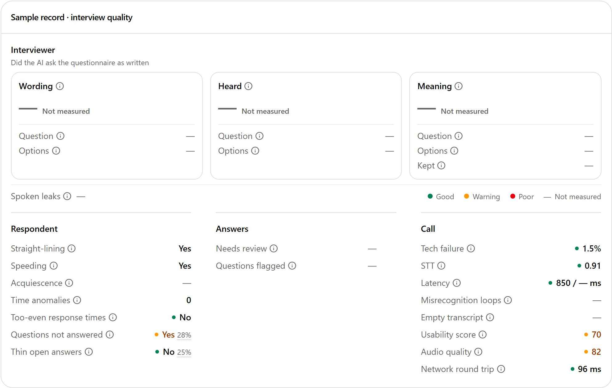

These measures judge the **AI interviewer and the call**, not the respondent. They appear in the **Interviewer** and **Call** groups of a sample record's quality panel, on the **AI review** card, and on the [Live Monitoring](/AI-CATI/Live-Monitoring#interview-quality) dashboard over the whole study.

<Frame>
  
</Frame>

---

## Questionnaire adherence

Did the AI ask the questionnaire as written? Each adherence figure is shown for the question and its options together (**Overall**), and for the **Question** text and the **Options** separately. The record's **Overall** verdict is the worst of its measured figures: one red makes it red.

### Wording

**What it measures:** how closely the AI interviewer's words matched the questionnaire text.

**How it is worked out:** the AI's reading of each question is compared with the questionnaire by text similarity (shared three-letter sequences, after lower-casing, removing accents and writing numbers the same way). For each question, the **first complete reading** is scored; each answer option must match at 60 in 100 or better to count as read. A question's score weighs the question text twice and the options once. The call figure is the average over the questions found.

**Unit:** 0 to 100 percent. **Limits:** green from 90, amber from 75, red below.

**How to read it:** a respondent talking over a question never lowers Wording: it is about what the AI said. Rephrasing lowers it; on a study type that allows paraphrase, a lower Wording with a high **Meaning** is fine.

### Heard

**What it measures:** how much of the questionnaire text actually reached the respondent before they answered.

**How it is worked out:** like Wording, but on the **latest** reading of each question, counting only the words that **played** before the respondent started speaking. Words cut off by the respondent talking over them count as not heard.

**Unit and limits:** as Wording.

**How to read it:** low Heard with high Wording means respondents answered before the question and its options were finished. That is common on long option lists, and the answer may rest on part of the list.

### Meaning: Asked

**What it measures:** whether the respondent got what the question means, even in other words.

**How it is worked out:** after the call, an AI judge compares each answered or refused question's reading with the questionnaire: **same** meaning 100, **weakened** 50, **changed** 0. Options are judged too: none missing or changed 100, only some missing 50, any changed or added 0. A question's score weighs the question twice and the options once.

**Unit:** 0 to 100 percent. A question the judge did not rate is left out of the average, never counted as 0.

### Meaning: Kept

**What it measures:** whether the saved answer really answers the question as written.

**How it is worked out:** the same judge rates each saved answer: answers the question 100, does not 0. A refusal is not rated.

**Example:** the respondent says "the economy" to a yes-or-no question and "yes" was saved: that answer is not kept.

### Repaired

**What it measures:** answers that were wrong at first and fixed after the AI read them back to the respondent.

**How it is worked out:** a repaired answer counts as kept (the saved data is correct) and is counted here. **Unit:** count. **How to read it:** how often the read-back was needed.

---

## AI review

**What it measures:** an overall judgement of the interview by an AI reviewer.

**How it is worked out:** after the call, the reviewer reads the transcript, the questionnaire outline and the call's outcome, and gives three scores from 1 to 10 (overall, interviewer, respondent), a pass or fail with a note for each criterion, and lists of strengths and issues. Whether the interview followed the questionnaire's routing is not part of the review: the survey engine enforces that.

| Criterion | Passes when |
| --- | --- |
| **Neutrality** (interviewer) | No leading, loaded or editorialising wording. |
| **One question at a time** (interviewer) | Never two questions bundled in one turn. |
| **Question fidelity** (interviewer) | The question is true to the questionnaire. For an opinion-polling study it must stay close to the wording; for a customer survey, paraphrase is allowed if the meaning and options survive. |
| **No acknowledgements** (interviewer) | No thanking or approving an answer mid-survey. A neutral bridge, answering the respondent's question, one empathy line, one thanks at a topic change and the closing are allowed. |
| **Refusal and end handling** (interviewer) | Refusals and an ineligible respondent are handled gracefully. |
| **Realism** (respondent) | The answers read like a real person's. |
| **Scenario adherence** (respondent) | In tests, the simulated respondent followed its script. |
| **Contradiction** (respondent) | No answers contradict each other. A fail feeds the [FRSI index](/AI-CATI/Metrics-Respondent-Behaviour#fear--repression-signal-frsi-m93). |

**Where:** the AI review card. A study can switch the review off.

---

## The call

### Response latency

**What it measures:** how long the respondent waited for the AI to reply after they stopped speaking.

**How it is worked out:** per turn, from the end of the respondent's speech to the start of the AI's voice. The record shows the median and the slowest 5 percent (p95) over the record's calls; the dashboard shows the median.

**Unit:** milliseconds. **Limits:** median green up to 1,500, amber up to 3,000; p95 green up to 3,000, amber up to 5,000. Lower is better.

**How to read it:** long waits make respondents repeat themselves, talk over the AI or hang up. See also [Audio and Timing](/AI-CATI/Metrics-Audio-and-Timing#response-latency).

### STT confidence

**What it measures:** how sure speech recognition was of what the respondent said.

**How it is worked out:** each recognized phrase comes with a confidence from the speech-recognition service; the call figure is the average over the phrases that have one.

**Unit:** 0 to 1; higher is better. **Limits:** judged against the study's confidence floor (0.60 by default): green from 0.15 above it.

**Standard / Live:** **Standard only.** The Live model does not report confidence, so the figure is not measured there.

**How to read it:** low confidence means answers may have been misheard; check them against the recording. Below 0.75 the usability score loses points.

### Technical failures

**What it measures:** the share of calls that ended in a technical failure, such as a speech-recognition, AI or voice service error, or a call that failed outright.

**Unit:** percent of calls. **Limits:** green at 0, amber up to 10. Lower is better.

### Misrecognition loops

**What it measures:** the interview got stuck asking again because the answer kept being misheard.

**How it is worked out:** flagged when 3 recognized phrases in a row came back below 0.60 confidence, or when the respondent gave the identical answer 3 times while the AI kept re-asking the same thing.

**Unit:** count of calls. **Limits:** see [colours](/AI-CATI/Metrics-Call-Quality#colours-on-the-dashboard).

### Empty transcript

**What it measures:** a connected call that left (almost) no transcript of the respondent, usually a speech-recognition or recording failure.

**How it is worked out:** flagged when the respondent has no lines, every line is blank, or half or more of the lines are blank. A single short but real answer is not empty.

**Unit:** count of calls. **Limits:** see [colours](/AI-CATI/Metrics-Call-Quality#colours-on-the-dashboard). Voice calls only.

### Spoken leaks

**What it measures:** the AI said aloud something meant only for itself.

**How it is worked out:** the AI's lines are checked for tool syntax, tool names, the questionnaire's internal question names (such as Q7a), tool arguments, and instruction text such as "current step" or a heading. Each hit counts one.

**Unit:** count. **Limits:** green at 0, amber at 1, red from 2. The same check runs on both pipelines; it is the Live pipeline's only guard.

### Answers needing review

**What it measures:** answers a person should look at before the data is used.

**How it is worked out:** after the call, an AI checks each saved answer against what the respondent said. An answer is marked when the saved code is not supported by what was said, or names a value not among the options. Answers the system set itself are not re-checked. The answers are listed on the Result tab with what was said and the suggested value.

**Unit:** count. **Limits:** green at 0, amber up to 2, red from 3.

### Questions flagged

**What it measures:** questions on which any check raised a flag: wording, what was heard, answer mapping, answer quality (a value outside the question's range or rules, or a required question left empty) or needs review.

**Unit:** count. Listed on the Result tab.

---

## Situations

**What it measures:** safety and conduct events on a call. The AI tags them during the call or after it.

Each situation, what the interviewer does about it, and how it affects the outcome code and callbacks are explained in [Call Situations](/AI-CATI/Call-Situations).

| Severity | Situations |
| --- | --- |
| **Urgent** | Crisis disclosure, domestic danger, a threat to others, a threat to staff. |
| **Review** | Sounds intoxicated, abusive, not answering seriously. |
| **Information** | Not safe to talk, emergency, distress in an answer, upset by a question, hearing difficulty, cannot continue because of hearing, a bad hour to call, an attempt to manipulate the AI. |

**How it is worked out:** each situation is tagged once per call. A situation **needs review** when it is urgent or for review, or when it was found after the call. Some situations also decide the call's outcome code, for example "not safe to talk" with nothing answered.

| Tile | Counts | Limits |
| --- | --- | --- |
| **Urgent situations** | Calls with an urgent situation. | Green at 0, amber at 1, red from 2, however large the study. |
| **Situations needing review** | Calls with a situation a person must look at, including every urgent one. | As above. |

Evidence for crisis, domestic danger and threats is restricted and not shown in the general call data.

All limits on this page are starting points that have not yet been calibrated on real fieldwork.
