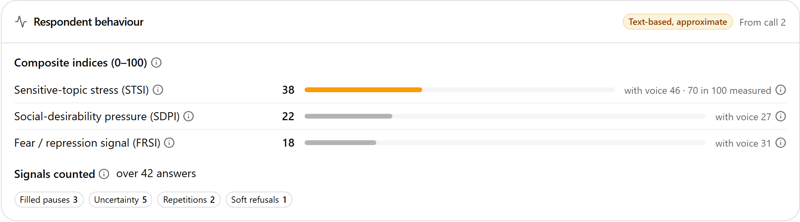

The **Respondent behaviour** card on a sample record shows signs that a respondent found questions sensitive, shaped answers to sound acceptable, or was under pressure. These are **indicators, not verdicts**: read them across many calls, and against the respondent's own neutral questions, never as proof about one person.

<Frame>
  
</Frame>

## How behaviour is read

Two kinds of evidence feed this page:

* **What was said.** After the call, an AI classifier reads each of the respondent's answers and marks every occurrence of a signal (a hesitation, an uncertainty word, a soft refusal...). The counting is done in code, so a single answer can contain several. If the classifier did not run (switched off for the study, or unavailable), these counts and the indices are shown as not measured: there is no word-list fallback.
* **How it was said.** Timing, pauses, pitch and loudness from the audio (see [Audio and Timing](/AI-CATI/Metrics-Audio-and-Timing)), compared between **sensitive** and **neutral** questions.

Rates are worked out per answer: a count divided by the number of the respondent's answers.

---

## Signals counted

### Filled pauses (M2.3)

**What it measures:** hesitation sounds or particles: "um", "uh", "er", "hmm", "well", or their equivalent in the call's language.

**How it is worked out:** each occurrence the classifier finds in the transcript counts one.

**Unit:** count. **How to read it:** a weak signal on the Standard pipeline, because speech recognition drops most hesitation sounds before the transcript is written. On Live English calls the sounds heard in the recording are also counted (see [Um and uh heard in the audio](/AI-CATI/Metrics-Audio-and-Timing#um-and-uh-heard-in-the-audio-m23-audio)).

### Self-corrections (M2.4)

**What it measures:** answers the respondent reversed or corrected part-way: "yes, no I mean...", "actually...".

**How it is worked out:** each occurrence the classifier finds counts one. **Unit:** count.

**How to read it:** a few are normal; many on one topic can mean the respondent was unsure or changed course to a safer answer.

### Repetitions (M2.5)

**What it measures:** the same word said twice in a row ("no no", "I I think").

**How it is worked out:** no AI involved. In each answer, every word identical to the word before it counts one, so "no no no" counts two. Works in any language and script.

**Unit:** count. **Watch out:** speech recognition sometimes collapses repeated words, so this undercounts on real calls.

### Uncertainty words (M6.1)

**What it measures:** doubt and hedging: "I think", "maybe", "not sure".

**How it is worked out:** each occurrence the classifier finds counts one. **Unit:** count.

**How to read it:** on its own a speech habit. It matters when it comes with slow answers: see [uncertainty with slow answers](#uncertainty-with-slow-answers-m62).

### Interruptions (M5.1)

**What it measures:** times speech was cut off by the other person speaking.

**How it is worked out:** counts the respondent's lines that started while the interviewer was still audible: each barge-in counts once. **Unit:** count.

### Asked to clarify (M5.2)

**What it measures:** the respondent asked the interviewer to repeat or explain. **How:** classifier occurrences. **Unit:** count.

**How to read it:** clusters on one question point to a question that is hard to understand on the phone.

### Asked for time (M5.3)

**What it measures:** requests for time: "give me a moment", "hold on". **How:** classifier occurrences. **Unit:** count.

### Soft refusals (M5.4)

**What it measures:** avoiding an answer without a hard no: "I'd rather not say", "prefer not to say", or "don't know" to something the respondent can know.

**How:** classifier occurrences. **Unit:** count.

**How to read it:** the strongest single signal of social-desirability pressure; it carries half of the SDPI index.

### Did not answer the question; asked to slow down

**Did not answer the question:** answers that did not address what was asked. **Asked to slow down:** the respondent asked the interviewer to slow down or repeat because they could not follow. Both are classifier occurrences, shown as badges.

---

## Sensitive-question contrasts

Each question is tagged **neutral**, **sensitive** or **high** sensitivity (see [Question sensitivity](#question-sensitivity-m102)). The contrasts compare how the respondent answered the sensitive and high questions against the neutral ones. Each answer is matched to the question it answered; when one interviewer turn asked several questions, that answer counts once.

The contrasts need tagged questions on both sides and audio. They are stored with the call and feed the indices; they are not shown as rows of their own.

### Sensitive-question latency (M4.1)

**What it measures:** whether the respondent took longer to start answering sensitive questions.

**How it is worked out:** the median time to answer on sensitive questions divided by the median on neutral questions. One measured answer on each side is enough.

**Unit:** ratio; 1 means no difference, 1.5 means half as long again on sensitive questions.

**How to read it:** the largest part of STSI. Answering more slowly on sensitive items than on neutral ones is the classic sign of careful or uncomfortable answering.

### Sensitive-question pauses (M4.2)

**What it measures:** whether answers to sensitive questions held more silent pauses.

**How it is worked out:** the median number of pauses per answer on sensitive questions divided by the median on neutral ones (also done for pause time). **Unit:** ratio; 1 means no difference.

### Sensitive-question speech rate (M4.3)

**What it measures:** whether the respondent spoke more slowly on sensitive questions.

**How it is worked out:** median speech rate on sensitive questions divided by neutral. **Unit:** ratio; below 1 means slower on sensitive questions.

### Prosodic shift (M4.4)

**What it measures:** whether the voice changed on sensitive questions, compared with the respondent's own neutral answers.

**How it is worked out:** for pitch and for loudness separately, how far the sensitive answers' average sits from the neutral answers' average, measured in the respondent's own neutral spread (standard deviations). The larger of the two is the shift. It needs at least two neutral answers to measure a spread, and at least three neutral answers before it counts in STSI.

**Unit:** standard deviations of the respondent's own neutral voice; 1 or more is a clear shift.

### Directional latency difference (M4.5)

**What it measures:** whether the respondent was slower to give one answer than another, for example slower to say "yes" than "no" across questions that share answer codes.

**How it is worked out:** answers are grouped by the value recorded; each group needs at least two answers, and there must be at least two groups. The figure is the average time to answer of the slowest group minus that of the fastest.

**Unit:** seconds.

**How to read it:** hesitating before one direction of answer can mean that answer felt less acceptable to say. It is the middle part of the voice SDPI.

### Question sensitivity (M10.2)

**What it measures:** how sensitive each question is.

**How it is worked out:** once per questionnaire, an AI reads the question titles and tags each one: **neutral** (demographics, everyday behaviour), **sensitive** (politics, religion, ethnicity, government approval, income and finances, health) or **high** (corruption, security, criticism of authorities).

Questions inside a panel are tagged one by one, like any other question.

**Where:** each question's row on the Result tab.

---

## Over the whole call

These are stored with each call; the trust trend is also on the admin **Call audio and timing** panel.

### Uncertainty with slow answers (M6.2)

**What it measures:** uncertainty language that came together with slow or pause-filled answers on sensitive questions.

**How it is worked out:** a text part (the hesitation rate, capped at 1) multiplied by a timing part (how far the sensitive-question latency or pause ratio sits above 1, full at 3). Because they are multiplied, either part at zero gives zero.

**Unit:** 0 to 1.

**How to read it:** hedging alone is a speech habit; slow answers alone can be a slow line. Only the two together count.

### Contradictions (M6.4)

**What it measures:** whether the AI review found answers contradicting each other.

**How it is worked out:** the AI reviewer's **Contradiction** criterion for the respondent; a fail counts one. **Unit:** 0 or 1. Feeds FRSI.

### Narrative answers (M6.5)

**What it measures:** how often the respondent gave long, story-like answers.

**How it is worked out:** the share of answers longer than 20 words. **Unit:** 0 to 1.

**How to read it:** in a closed-question survey, many long answers can mean justifying or hedging, or simply a talkative respondent.

### Trust trend (M7.1)

See [Latency drift and trust trend](/AI-CATI/Metrics-Audio-and-Timing#latency-drift-and-trust-trend-m15-m71).

### Fatigue (M7.2)

See [Signs of fatigue in the voice](/AI-CATI/Metrics-Call-Quality#signs-of-fatigue-in-the-voice-m72).

---

## Composite indices

Each index runs from 0 to 100; higher means more of the signal. The bar colour is only a reading aid: under 25 low, 25 to 50 moderate, 50 and above high. The scales are not yet calibrated on real fieldwork.

Each index has two versions:

* **Text-based** (the number on the left): from the transcript and the answers, available on every call where the classifier ran. Speech recognition removes most hesitation sounds, so it is an approximation; the card says **Text-based, approximate**.
* **With voice** (on the right): adds what the recording shows. Shown only when the call's audio could be measured.

The rates below are counts per answer, each scaled to 0..1 against a cap: soft refusals full at 0.30 per answer, uncertainty at 0.50, hesitation at 1.00. **Hesitation** = filled pauses + self-corrections + repetitions + uncertainty words, per answer.

### Sensitive-topic stress (STSI, M9.1)

**What it measures:** signs of strain on sensitive questions.

**How it is worked out:**

* **Text:** 40 × slower answers on sensitive questions + 30 × soft refusals. (Slower answers count from a latency ratio of 1, full at 3.) The text version tops out at 70.
* **With voice:** 40 × slower answers on sensitive questions + 30 × more pauses on sensitive questions (full at a pause ratio of 3) + 30 × prosodic shift (full at 2 standard deviations).

**How to read it:** needs tagged questions. When no question on the call was tagged, the card says so: STSI is then missing its largest part and cannot be compared with a call that had tagged questions.

### Social-desirability pressure (SDPI, M9.2)

**What it measures:** signs the respondent was shaping answers to sound acceptable.

**How it is worked out:**

* **Text:** 50 × soft refusals + 30 × uncertainty + 20 × hesitation.
* **With voice:** 50 × soft refusals + 30 × directional latency difference (full at 2 seconds) + 20 × hesitation.

### Fear / repression signal (FRSI, M9.3)

**What it measures:** signs that the respondent felt unsafe answering.

**How it is worked out:**

* **Text:** 40 × STSI + 40 × a hang-up + 20 × contradictions found by the AI review.
* **With voice:** 40 × the voice STSI + 40 × a hang-up + 20 × voice strain on sensitive questions (jitter, shimmer and harmonics-to-noise compared with neutral answers).

**How to read it:** a hang-up alone puts FRSI at 40; read it with the hang-up point and the questions around it.

### When a part is not measured

In the voice versions (version 3, from 23 November 2026), a part the call did not measure is **left out** and the other weights are scaled up to 100. When less than half of an index's weight was measured, the voice score is not shown. When less than the full formula was measured, the card says how much, for example **"with voice 46 · 70 in 100 measured"**. Voice scores from before version 3 are not comparable.
