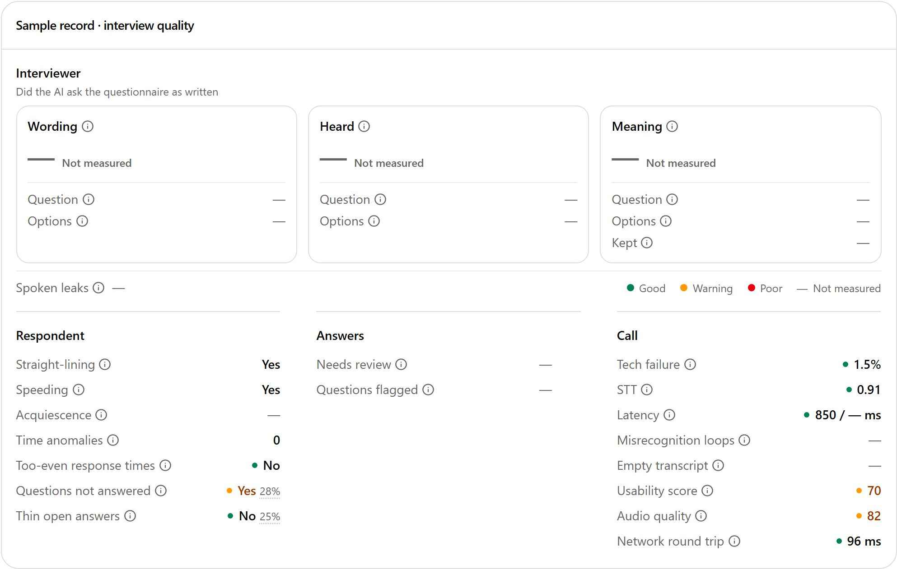

A **sample record** is one person (one row of your sample) in an AI-CATI study. Its page shows everything that happened to that record: every call, its recording and transcript, and the answers given.

Open a record from **Open** on the [Results](/AI-CATI/Results-and-Export) tab, from a pre-test run, or from a sub-sample run's records table. **Back to results** (or **Back to pre-test run**) returns you to the list with your filters kept.

## Record header

| Field | Meaning |
| --- | --- |
| **Status** | See the table below. |
| **Key type** | **Phone**, or **Composite (phone and external ID)**. |
| **External sample ID** | The ID from your sample file, if it has one. |
| **Enrolled** | When the record entered the campaign. |
| **Number of calls** | How many calls have been placed. |
| **Last event** | When something last happened to the record. |
| **Phone** | Masked. Select **reveal** to show the full number and **hide** to mask it again. |

If a callback is booked, a notice shows when: "A callback is scheduled for …".

Select **Export record** to download this record's data.

| Record status | Meaning |
| --- | --- |
| Pending | Not called yet; waiting for its first call. |
| In progress | Called at least once and not settled yet. A call may be on the line right now. |
| Callback scheduled | A callback is booked, and the record is waiting for it. |
| Finished | Settled with a completed interview. |
| Partial | Reached, but the interview stopped before the end. Settled and not called again. |
| Closed | Settled without an interview, for example a refusal or all attempts used. Not called again. |
| Waiting for capacity | No calling line came free in time, so the number was never dialled and nothing was spent. |

## Call history

The **Call history** tab lists every attempt, oldest first.

| Column | Description |
| --- | --- |
| **Attempt No.** | For example "2 of 6", against the study's maximum attempts. |
| **Call time** / **Duration** | When the call was placed and how long it lasted. |
| **AAPOR · Next call** | The call's AAPOR disposition and, if the record will be called again, when. |
| **Voice** | **Play** or **Download** the recording. If nothing was recorded, the reason is shown, for example the respondent declined recording, consent was not asked, or recording is off for the study. |
| **Transcript** | **View transcript**, when one is available. |

### Call details

Each call row also carries a few facts about the call itself:

| Detail | Where | What it tells you |
| --- | --- | --- |
| **Answered by** | Under the call's outcome | The carrier's answering-machine detection: **a person**, **an answering machine**, **a fax** or **unknown**. Hover for the carrier's exact verdict, the action taken, and how many times the respondent spoke after the verdict. A machine verdict followed by respondent turns means a person was taken for a machine. |
| **Ring time** | Hover over the **Duration** | How long the phone rang before it was answered, in seconds, and what the duration was measured between. |
| **Language** | Beside the call | The language the call ran in, and **asked for** a language when the respondent asked for a different one. Hover for how the language was chosen. A language asked for but not given is a language barrier on that call. |
| **Recording** | The **Voice** column | When nothing was kept, why (see the table above). |

**Dial and callback audit** lists each dial and callback with when it happened, who triggered it (the **AI interviewer** or the **calling rules**), the caller ID used and the outcome.

### Call transcript

**View transcript** opens the conversation turn by turn:

* **AI** and **Resp** (respondent) turns, each respondent turn with its STT confidence, and an **interrupted** marker where someone was cut off.
* An audio player to play, pause and seek the recording, and **Download the recording**.
* **Download as text** to save the transcript.
* An option to **show technical events**: what the system recorded during the call, such as answers saved or changed, questions skipped because they do not apply, a respondent who did not qualify, the call outcome, and notes the system gave the AI (for example that an answer was unclear or the line went quiet). Answers flagged **Needs review** may not match what was said.

<Warning>
  Recordings and transcripts contain personal data. Download and share them only in line with your organization's data-protection rules and the consent respondents gave.
</Warning>

## Result

The **Result** tab shows the answers per question (Q1, Q2, …) for the **fielded version** of the questionnaire. Each question shows its answer and a status badge:

| Badge | Meaning |
| --- | --- |
| **Answered** | The respondent gave an answer. |
| **Not answered** | The question was asked but no answer was recorded. |
| **Skipped** | The question did not apply. |
| **Not asked** | The question was never reached. The reason is shown, for example the survey logic skipped it, the call ended before it, a callback is booked, or the call dropped because of a technical failure. |
| **Derived** | A computed value, never asked on the call. |

When the post-call checks ran, each question also shows what they found: the wording and meaning checks, whether the saved answer matches what was said, and the AI interviewer's **tool decisions** on that question. A decision marked **Wrong call** means the check found the interviewer should not have done it there, for example ending the interview, handing over to another person or saving an answer the respondent had not given.

Select **Download this record's result** to save the answers as a file. A partial record may have blank later questions.

| Message | What it means |
| --- | --- |
| No interview has resolved for this record yet | There are no answers to show yet. |
| This record broke off part-way and its partial answers have not been ingested | The partial interview was not saved. |
| Answer ingest is not configured for this study | Per-question answers are unavailable. |

## Interview quality

The quality panel summarises the record's calls:

| Measure | Meaning |
| --- | --- |
| **Script adherence** | How closely the AI interviewer kept to the questionnaire's wording, in percent. |
| **STT confidence** | How sure speech recognition was of what the respondent said (0 to 1). |
| **Latency p50 / p95** | The typical and 95th-percentile time the AI took to reply. |
| **Speedsters flagged** / **Straight-liners flagged** | Calls flagged for answering too fast, or for giving the same answer question after question. Zero is healthy. |
| **Response-time anomalies** | Answers with an unusual response time. Zero is healthy. |
| **Technical failure rate** | The share of the record's calls that ended in a technical failure. Zero is healthy. |
| **Usability score**, **Audio quality**, **Network round trip** | Whether the record's interviews are usable for analysis, the recording's signal quality, and (Live) the round trip to the AI server. |
| **Too-even response times**, **Questions not answered**, **Thin open answers** | Respondent quality checks raised on the record's calls, with the share behind the last two. |

<Frame>
  
</Frame>

## Call quality, behaviour and audio

For the call selected in the call history, the record also shows:

* **Call quality**: the usability score and band, audio quality, reliability, line type, the respondent quality checks and the answer patterns. See [Call Quality](/AI-CATI/Metrics-Call-Quality).
* **Respondent behaviour**: the STSI, SDPI and FRSI indices and the signals behind them. See [Respondent Behaviour](/AI-CATI/Metrics-Respondent-Behaviour).
* **AI review**: the AI reviewer's score and criteria. See [Interviewer Quality](/AI-CATI/Metrics-Interviewer-Quality#ai-review).
* **Callback offers**: the callback times offered and agreed on that call. **A callback was asked for, but no tool recorded it** means the respondent asked to be called back and the AI booked nothing: book it by hand if it is still wanted.
* **Call audio and timing** (platform admins only): timing, pauses, pitch, loudness and voice quality from the recording. See [Audio and Timing](/AI-CATI/Metrics-Audio-and-Timing).
* **Engine diagnostics** (platform admins only), for investigating a call that ended early or stalled:
  * **Turn progression**: each turn's question served and the next one, with a question served again and again marked as a loop, and counts of re-phrased and restarted questions.
  * **Batch reconciliation**: the questions served to the AI that it never submitted an answer for.
  * **Unresolved conditions**: questionnaire conditions the survey logic could not decide.

## Related pages

* [Interview Metrics: Overview](/AI-CATI/Metrics-Overview)
* [Results and Export](/AI-CATI/Results-and-Export)
* [Tests: Self-tests and Pre-tests](/AI-CATI/Tests-Pre-tests-and-Self-tests)
