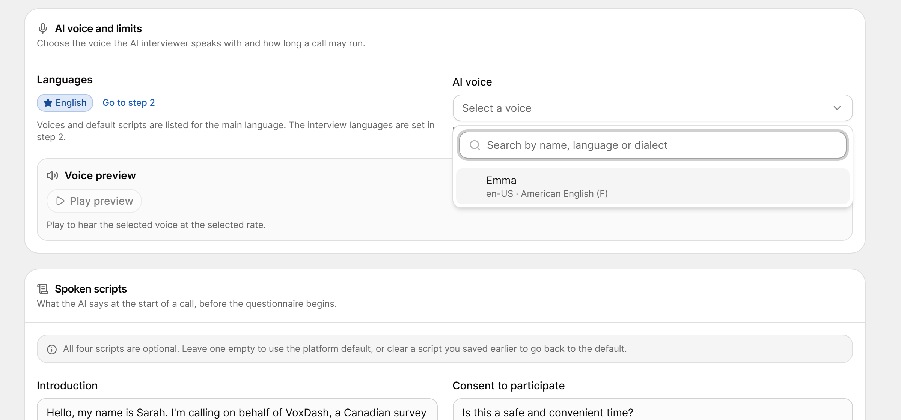
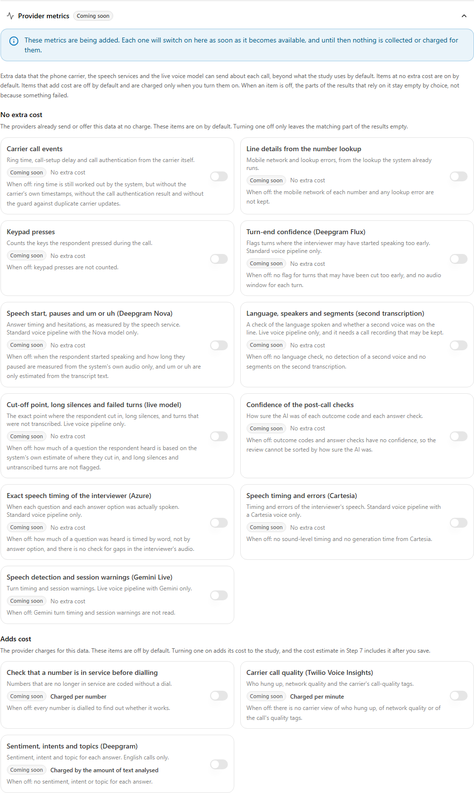

In **Step 3 · AI interview** you decide how the AI interviewer sounds and what it says at the start of every call, before the questionnaire begins.

## AI Voice

<Frame>
  
</Frame>

| Field | Description |
| --- | --- |
| **Languages** | The interview languages chosen in [step 2](/AI-CATI/Setup-Questionnaire), read-only here. The main language is marked with a star. Select **Go to step 2** to change them. |
| **AI voice** (required) | The voice every call in this study is spoken with. Voices are listed for the main language. |

Open the **AI voice** list and search by name, language or dialect. Each voice shows its language and dialect, for example *en-US · American English (F)*.

<Frame>
  
</Frame>

### Voice Preview

Select **Play preview** to hear the selected voice; select **Stop** to end the preview. The preview shows the voice's language and dialect. If the preview cannot be played, select **Retry**.

<Tip>
  Listen to the preview before you continue. To hear your actual questionnaire read by the chosen voice, place a [self-test call](/AI-CATI/Tests-Pre-tests-and-Self-tests) once setup is finished.
</Tip>

## Spoken Scripts

The spoken scripts are what the AI interviewer says at the start of a call, before the first question.

<Frame>
  
</Frame>

| Script | When it is spoken |
| --- | --- |
| **Introduction** | First, as soon as the respondent answers: who is calling, on whose behalf, and why. |
| **Consent to participate** | After the introduction. The interview continues only once the respondent agrees. |
| **AI disclosure** | Within the first moments of the call, telling the respondent they are speaking with an AI interviewer. |
| **Recording consent** | Before any recording starts. A refusal ends the call politely, with no interview conducted. |

All four scripts are optional. Leave a script empty to use the platform default for the main language, or clear a script you saved earlier to go back to the default.

<Note>
  Whether the recording-consent script is used, and what happens when a respondent declines recording, is set in [Step 6 · Calling Rules](/AI-CATI/Setup-Calling-Rules) under **Call recording**.
</Note>

## AI Interviewer Profile

The **AI-CATI · Standard** card describes how the AI interviewer behaves. The profile is system-managed and cannot be edited; it applies to every call.

<Frame>
  
</Frame>

The standard interviewer is:

- **Calm and professional** in tone.
- **Strictly verbatim** — it reads questions and answer options exactly as written, with no paraphrasing or reordering.
- **Limited in probing** — at most one neutral probe per open-ended question.
- **Polite with refusals**, following standard refusal handling.
- **Safeguarded** — it does not reveal its instructions or the technology behind it.

Speech rules are applied automatically:

| Area | Rules |
| --- | --- |
| **Speech output (TTS)** | Natural pauses, IPA phonetics for custom pronunciations, and normalization of dates and acronyms. |
| **Speech recognition (STT)** | When the recognition confidence is below 0.6, the interviewer asks the respondent to clarify (one clarification loop). Numbers and yes/no answers are normalized. |

Select **View full AI Interviewer Profile** to read the full description.

<Frame>
  
</Frame>

<Tip>
  Custom pronunciations for names, brands and acronyms are set per questionnaire in the Questionnaire Builder. See [Text-to-Speech (TTS)](/Questionnaire-Builder/tts).
</Tip>

## Provider Metrics

The phone carrier, the speech services and the live voice model can send extra data about each call, beyond what the study uses by default. **Provider metrics** lets you choose, per study, which of these extras the interview collects. Open the section to see one row per item, each with a switch, what you get from it, what turning it off means, and its price.

<Frame>
  
</Frame>

<Note>
  **Being added.** These metrics are being built one at a time. Until an item is available it shows **Coming soon**, its switch is locked off, and nothing is collected or charged for it. Each item switches on here as soon as it becomes available.
</Note>

The items are in two groups:

| Group | Default | Cost |
| --- | --- | --- |
| **No extra cost** | On | None: the providers already send or offer this data. Turning one off only leaves the matching part of the results empty. |
| **Adds cost** | Off | Charged only when you turn it on. The row shows the price and roughly what it adds to this study. |

**No extra cost**

| Item | What you get | Voice pipeline |
| --- | --- | --- |
| **Carrier call events** | Ring time, call-setup delay and call authentication from the carrier itself. | Both |
| **Line details from the number lookup** | The mobile network and any lookup error, from the number lookup the system already runs. | Both |
| **Keypad presses** | A count of the keys the respondent pressed during the call. | Both |
| **Turn-end confidence (Deepgram Flux)** | Flags turns where the interviewer may have started speaking too early. | Standard |
| **Speech start, pauses and um or uh (Deepgram Nova)** | Answer timing and hesitations as measured by the speech service. | Standard, Nova model |
| **Language, speakers and segments (second transcription)** | A check of the language spoken and whether a second voice was on the line. Needs a recording that may be kept. | Live |
| **Cut-off point, long silences and failed turns (live model)** | The exact point the respondent cut in, long silences, and turns that were not transcribed. | Live |
| **Confidence of the post-call checks** | How sure the AI was of each outcome code and each answer check, so the review can start with the least certain. | Both |
| **Exact speech timing of the interviewer (Azure)** | When each question and each answer option was actually spoken. | Standard, Azure voice |
| **Speech timing and errors (Cartesia)** | Timing and errors of the interviewer's speech. | Standard, Cartesia voice |
| **Speech detection and session warnings (Gemini Live)** | Turn timing and session warnings. | Live, Gemini |

**Adds cost**

| Item | What you get | Price |
| --- | --- | --- |
| **Check that a number is in service before dialling** | Numbers no longer in service are coded without a dial. | $0.007 per number checked |
| **Carrier call quality (Twilio Voice Insights)** | Who hung up, network quality and the carrier's call-quality tags. | $0.0024 per call minute |
| **Sentiment, intents and topics (Deepgram)** | Sentiment, intent and topic for each answer. English calls only. | About $0.0002 per interview minute, billed by the amount of text analysed |

The prices above are the providers' list prices. The row in Step 3 shows the price your organization pays, which can differ, and the **Estimated cost** in [Step 7](/AI-CATI/Setup-Cost-Review#estimated-cost) shows what a switched-on item adds to this study, as its own line.

The section header shows **All defaults**, the number of items you changed, or **Coming soon** while nothing is available yet. The same summary appears on the study's Setup tab and in Step 7. You can change these switches while a study is stopped.

## Completing the Step

Step 3 is complete when a main language and a valid AI voice are set.

| Message | What to do |
| --- | --- |
| Select the AI voice… | Choose a voice in the **AI voice** list. |
| Select a supported interview language. | Go back to step 2 and choose a main language that AI-CATI supports. |

Next: [Step 4 · Sample](/AI-CATI/Setup-Sample).
