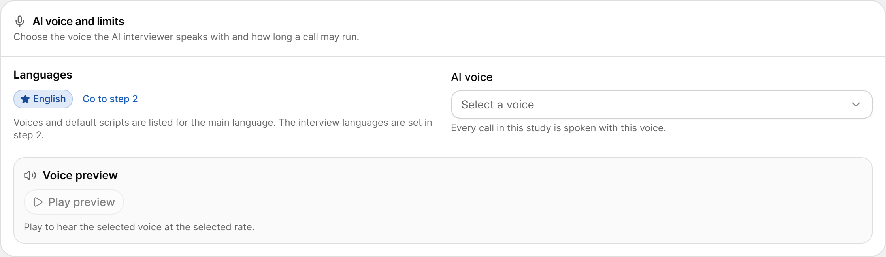
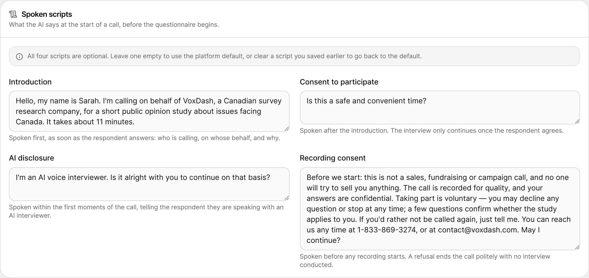
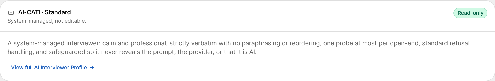
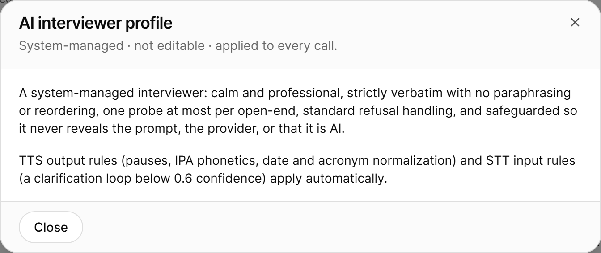

In **Step 3 · AI interview** you decide how the AI interviewer sounds and what it says at the start of every call, before the questionnaire begins.

## AI Voice

<Frame>
  
</Frame>

| Field | Description |
| --- | --- |
| **Languages** | The interview languages chosen in [step 2](/AI-CATI/Setup-Questionnaire), read-only here. The main language is marked with a star. Select **Go to step 2** to change them. |
| **AI voice** (required) | The voice every call in this study is spoken with. Voices are listed for the main language. |

Open the **AI voice** list and search by name, language or dialect. Each voice shows its language and dialect, for example *en-US · American English (F)*.

<Frame>
  
</Frame>

### Voice Preview

Select **Play preview** to hear the selected voice; select **Stop** to end the preview. The preview shows the voice's language and dialect. If the preview cannot be played, select **Retry**.

<Tip>
  Listen to the preview before you continue. To hear your actual questionnaire read by the chosen voice, place a [self-test call](/AI-CATI/Tests-Pre-tests-and-Self-tests) once setup is finished.
</Tip>

## Spoken Scripts

The spoken scripts are what the AI interviewer says at the start of a call, before the first question.

<Frame>
  
</Frame>

| Script | When it is spoken |
| --- | --- |
| **Introduction** | First, as soon as the respondent answers: who is calling, on whose behalf, and why. |
| **Consent to participate** | After the introduction. The interview continues only once the respondent agrees. |
| **AI disclosure** | Within the first moments of the call, telling the respondent they are speaking with an AI interviewer. |
| **Recording consent** | Before any recording starts. A refusal ends the call politely, with no interview conducted. |

All four scripts are optional. Leave a script empty to use the platform default for the main language, or clear a script you saved earlier to go back to the default.

<Note>
  Whether the recording-consent script is used, and what happens when a respondent declines recording, is set in [Step 6 · Calling Rules](/AI-CATI/Setup-Calling-Rules) under **Call recording**.
</Note>

## AI Interviewer Profile

The **AI-CATI · Standard** card describes how the AI interviewer behaves. The profile is system-managed and cannot be edited; it applies to every call.

<Frame>
  
</Frame>

The standard interviewer is:

- **Calm and professional** in tone.
- **Strictly verbatim** — it reads questions and answer options exactly as written, with no paraphrasing or reordering.
- **Limited in probing** — at most one neutral probe per open-ended question.
- **Polite with refusals**, following standard refusal handling.
- **Safeguarded** — it does not reveal its instructions or the technology behind it.

Speech rules are applied automatically:

| Area | Rules |
| --- | --- |
| **Speech output (TTS)** | Natural pauses, IPA phonetics for custom pronunciations, and normalization of dates and acronyms. |
| **Speech recognition (STT)** | When the recognition confidence is below 0.6, the interviewer asks the respondent to clarify (one clarification loop). Numbers and yes/no answers are normalized. |

Select **View full AI Interviewer Profile** to read the full description.

<Frame>
  
</Frame>

<Tip>
  Custom pronunciations for names, brands and acronyms are set per questionnaire in the Questionnaire Builder. See [Text-to-Speech (TTS)](/Questionnaire-Builder/tts).
</Tip>

## Post-call Checks

After each call ends, a set of checks reviews it: they read the transcript and the saved answers and produce the quality figures and reviews described in [Interview Metrics](/AI-CATI/Metrics-Overview). **Post-call checks** lets you turn individual checks off for this study. All are on by default; the section header shows **All on** or how many are off, and the same summary appears on the study's Setup tab and in Step 7.

The checks never run during the call, so turning one off does not change how the interview is conducted. They are in two groups.

**Review only.** Turning one of these off leaves that part of the post-call results empty; the call's record stays the same.

| Check | What it does | Off means |
| --- | --- | --- |
| **Overall interview judge** | Rates how well the whole interview went. | No [AI review](/AI-CATI/Metrics-Interviewer-Quality#ai-review) score; the contradiction part of [FRSI](/AI-CATI/Metrics-Respondent-Behaviour#fear--repression-signal-frsi-m93) is not measured. |
| **Respondent-turn classifier** | Labels what each respondent turn was, such as an answer, a question or a refusal. | The [signals counted](/AI-CATI/Metrics-Respondent-Behaviour#signals-counted) from what was said, and the text-based indices, show as not measured. |
| **Topic sensitivity tagger** | Marks the questions that touch on sensitive topics. | No [question sensitivity](/AI-CATI/Metrics-Respondent-Behaviour#question-sensitivity-m102), so the sensitive-question contrasts are not computed. |
| **Answer mapping check** | Checks that each answer was saved as the option the respondent meant. | No [answers needing review](/AI-CATI/Metrics-Interviewer-Quality#answers-needing-review) from this check. |
| **Grid answer mapping check** | The same check for answers to grid questions. | As above, for grid questions. |
| **Interviewer tool-decision check** | Checks the decisions the AI made during the call, such as saving an answer or ending the call. | No **Wrong call** marks on the [Result tab](/AI-CATI/Sample-Records#result). |
| **Question meaning check** | Checks that each question kept its meaning when the AI asked it. | Every question reads "not judged" for [meaning](/AI-CATI/Metrics-Interviewer-Quality#meaning-asked). |
| **Answer quality check** | Rates how complete and usable each answer is. | Answer quality is not checked. |
| **Quality flags** | Flags calls that show signs of poor quality. | No [respondent quality checks](/AI-CATI/Metrics-Call-Quality#respondent-quality-checks). |
| **Spoken-leak check** | Finds internal tool names or ids that the AI said aloud. | No [spoken leaks](/AI-CATI/Metrics-Interviewer-Quality#spoken-leaks) count. |
| **Question wording adherence** | Compares the wording the AI used with the questionnaire's wording. | No [Wording or Heard](/AI-CATI/Metrics-Interviewer-Quality#questionnaire-adherence) score, and the meaning check has nothing to read either. |
| **Behavioral metrics** | Works out the behavioral metrics and composite scores for the call. | No [Respondent behaviour](/AI-CATI/Metrics-Respondent-Behaviour) figures or indices. |

**Changes the call's record.** These checks can change what is saved for a call. You can turn them off, but information can be lost or coded less precisely, so turning one off first asks you to confirm, and a warning stays under the row while it is off.

| Check | What it does | Off means |
| --- | --- | --- |
| **Post-call callback check** | Records a do-not-call request or a callback reply that the AI did not record during the call. | A respondent who asked never to be called again, and whom the AI missed, can be dialled again; a callback time accepted or declined just before hanging up is not booked or cancelled. |
| **Data request check** | Records a respondent's request to delete, not use, see or correct their data that the AI did not record. | Such a request the AI missed is not passed on, and the answers are kept and used as normal. |
| **Held answer recovery** | When the respondent hangs up, saves answers the AI heard but had not saved yet. | The last few answers before a hang-up or a dropped line can be missing, and the interview can count as less complete than it was. |
| **AI outcome coding** | The AI chooses the call's final AAPOR outcome code. | Only the AI's choice is skipped: completes, partials, screen-outs, do-not-call requests, booked callbacks, answering machines and filled quotas are still coded by rule. Other calls, such as most refusals and break-offs, get a simpler fallback code (2.12 break-off, 2.11 refusal or 3.21 unknown) and are marked for review; response rates that use them may need a manual check. |

<Note>
  An empty part of the results is not a clean result when its check was off: the call's analysis records which checks were off. You can change these switches while a study is stopped.
</Note>

## Provider Metrics

The phone carrier, the speech services and the live voice model can send extra data about each call, beyond what the study uses by default. **Provider metrics** lets you choose, per study, which of these extras the interview collects. Open the section to see one row per item, each with a switch, what you get from it, what turning it off means, and its price.

<Frame>
  
</Frame>

<Note>
  **Being added.** These metrics are being built one at a time. Until an item is available it shows **Coming soon**, its switch is locked off, and nothing is collected or charged for it. Each item switches on here as soon as it becomes available.
</Note>

The items are in two groups:

| Group | Default | Cost |
| --- | --- | --- |
| **No extra cost** | On | None: the providers already send or offer this data. Turning one off only leaves the matching part of the results empty. |
| **Adds cost** | Off | Charged only when you turn it on. The row shows the price and roughly what it adds to this study. |

**No extra cost**

| Item | What you get | Voice pipeline |
| --- | --- | --- |
| **Carrier call events** | Ring time, call-setup delay and call authentication from the carrier itself. | Both |
| **Line details from the number lookup** | The mobile network and any lookup error, from the number lookup the system already runs. | Both |
| **Keypad presses** | A count of the keys the respondent pressed during the call. | Both |
| **Turn-end confidence (Deepgram Flux)** (available) | Turns the speech service closed while the respondent was still talking, and how sure it was at each turn end. | Standard, Flux model |
| **Speech start, pauses and word confidence (Deepgram Nova)** (available) | When the respondent started speaking, the pauses inside answers and the least surely heard word, as measured by the speech service. Um and uh are not collected here. | Standard, Nova model |
| **Language, speakers and segments (second transcription)** (available) | Whether a second voice was on the line and, on a call that did not start in one language, the language spoken. Needs a recording that may be kept. | Live |
| **Cut-off point and failed turns (live model)** (available) | How much of each reply the respondent heard before they cut in, and the turns the AI server failed to transcribe. | Live, OpenAI |
| **Confidence of the post-call checks** *(available)* | How sure the AI was of each outcome code and each answer check, so the review can start with the least certain. See [AI judge confidence](/AI-CATI/Sample-Records#ai-judge-confidence-aapor-code). | Both |
| **Exact speech timing of the interviewer (Azure)** (available) | How long and how fast the interviewer spoke, and any gaps in its audio, as reported by the voice service. | Standard, Azure voice |
| **Speech timing and errors (Cartesia)** (available) | How fast the interviewer spoke, how long each sentence took to generate, and the errors the voice service sent. | Standard, Cartesia voice |
| **Speech detection and session warnings (Gemini Live)** | Turn timing and session warnings. | Live, Gemini |

**Adds cost**

| Item | What you get | Price |
| --- | --- | --- |
| **Check that a number is in service before dialling** | Numbers no longer in service are coded without a dial. | $0.007 per number checked |
| **Carrier call quality (Twilio Voice Insights)** | Who hung up, network quality and the carrier's call-quality tags. | $0.0024 per call minute |
| **Sentiment, intents and topics (Deepgram)** | Sentiment, intent and topic for each answer. English calls only. | About $0.0002 per interview minute, billed by the amount of text analysed |

The prices above are the providers' list prices. The row in Step 3 shows the price your organization pays, which can differ, and the **Estimated cost** in [Step 7](/AI-CATI/Setup-Cost-Review#estimated-cost) shows what a switched-on item adds to this study, as its own line.

The section header shows **All defaults**, the number of items you changed, or **Coming soon** while nothing is available yet. The same summary appears on the study's Setup tab and in Step 7. You can change these switches while a study is stopped.

## Completing the Step

Step 3 is complete when a main language and a valid AI voice are set.

| Message | What to do |
| --- | --- |
| Select the AI voice… | Choose a voice in the **AI voice** list. |
| Select a supported interview language. | Go back to step 2 and choose a main language that AI-CATI supports. |

Next: [Step 4 · Sample](/AI-CATI/Setup-Sample).
